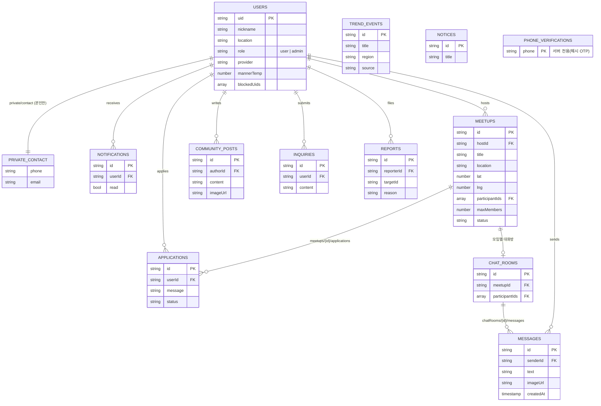

# OOMU (우리 동네 취향 모임 / Spot10)

## 📌 프로젝트 개요 및 아키텍처
본 프로젝트는 **데이터 특성에 따른 이원화 스토리지 아키텍처**를 채택하고 있습니다.

1. **Firebase Firestore (텍스트 / 보안 / 실시간 데이터)**
   - 모임 정보, 사용자 프로필, 실시간 대화방 메시지, 매너 온도 관리
   - 비밀값(SMS·R2·소셜 로그인 시크릿)은 Firestore에 저장하지 않고 서버 프록시(Secret Manager)에서만 보관
2. **Cloudflare R2 (`oomu-spot`) (고성능 대용량 사진 스토리지)**
   - 프로필 사진, 모임 커버 사진, 대화방 공유 사진 전용
   - 서버가 발급한 5분 만료 Presigned PUT URL로 업로드 (앱에 R2 키 없음)
3. **서버 프록시 (`functions/`, Firebase Functions v2)**
   - `/api/sms/send·verify`, `/api/r2/sign-upload`, `/api/auth/naver·kakao`
---

## 🔒 보안 원칙 (Zero-Secret Policy)
> **개인정보와 모든 시크릿 키는 GitHub·Firestore·웹 번들에 두지 않습니다.**

- SMS(Solapi)·R2·네이버 시크릿은 서버 프록시 환경변수/Secret Manager에만 존재합니다.
- 클라이언트는 프록시가 발급한 Presigned URL·Custom Token만 사용합니다.
- 비공개 연락처는 `users/{uid}/private/contact`에 분리하며 본인만 읽을 수 있습니다.

---

## 🗄️ 데이터 모델 (ERD)
Firestore 보안 규칙(`firestore.rules`)과 서비스 코드 기준입니다. 필드는 핵심만 표기했습니다.

- `TREND_EVENTS`·`NOTICES`는 공개 읽기 전용, `PHONE_VERIFICATIONS`는 서버(Admin SDK)만 접근합니다.
- 일부 과거 문서는 `members`가 문자열/배열로 혼재하며 단일 읽기 규약으로 정리 중입니다.

---
## 🛠️ 프로젝트 단일 지침서 (SSOT)
- **[OOMU 단일 전체 지침서 (AGENTS.md)](AGENTS.md)**: 전체 설계, 아키텍처, 60-30-10 디자인 시스템, 세션 정합성
- **[OOMU 단일 보안 지침서 (SECURITY.md)](SECURITY.md)**: 0-Secret & 0-PII 보안 원칙, 외부 API 키 관리, 자동 사전 검증 표준
