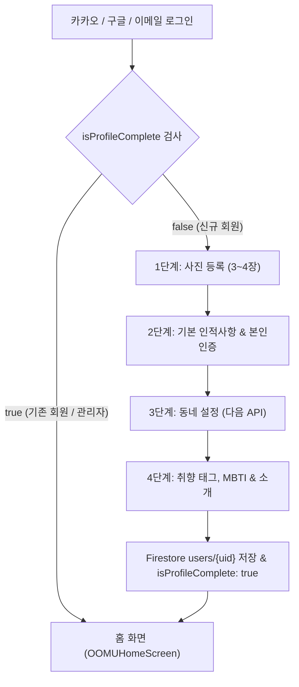

# 🌿 OOMU(우무) 인증 및 온보딩 프로필 설정 지침서

본 문서는 OOMU 앱의 **카카오 개발자 센터 연동**, **Firebase 인증(Authentication) 연동**, **대기업(위피·글램·틴더) 기준 4단계 프로필 온보딩 시스템**, 그리고 **권한별 UI 노출 보안 규칙**을 정리한 개발 및 운영 가이드입니다.

---

## 1. 카카오 개발자 센터 (Kakao Developers) 연동 정보

| 항목 | 설정값 및 상세 내용 |
| :--- | :--- |
| **애플리케이션 이름** | **우무 (OOMU)** |
| **REST API 키** | `3f91399ac9b6731d96f6d4b9ac13c502` |
| **Redirect URI** | `https://ahn-works.github.io/datating_test/` |
| **인가 코드 요청 URL** | `https://kauth.kakao.com/oauth/authorize?client_id=3f91399ac9b6731d96f6d4b9ac13c502&redirect_uri=https://ahn-works.github.io/datating_test/&response_type=code` |
| **토큰 발급 엔드포인트** | `POST https://kauth.kakao.com/oauth/token` |
| **사용자 정보 조회** | `GET https://kapi.kakao.com/v2/user/me` |

### Firebase Authentication 자동 바인딩 흐름
1. 사용자가 카카오 로그인 버튼 클릭 ➔ 공식 카카오 인가창 열림
2. 카카오 로그인 후 `redirect_uri`로 `?code=xxxx` 파라미터와 함께 복귀
3. `authService.handleKakaoOAuthCode(code)`가 카카오 토큰 및 프로필(닉네임, 이메일, 프로필 이미지) 수신
4. Firebase Auth 계정 자동 연동 및 Firestore `users/{uid}` 문서 동기화 (`_syncUserWithFirestore`)

---

## 2. 4단계 프로필 온보딩 시스템 (`ProfileSetupScreen`)

위피(Wippy), 글램(Glam), 틴더(Tinder), 문토(Munto) 등 국내외 1위 소셜 데이팅·모임 앱의 표준 UX/UI 규격을 적용했습니다.

### 단계별 상세 기능
- **1단계: 프로필 사진 등록 (3~4장)**
  - 대표 슬롯 (2x2): 정면 얼굴 실루엣 가이드 기본 배치 (`정면 얼굴 사진 추가`)
  - 서브 슬롯 (3개): 일상, 취미, 카페 사진 추가 슬롯 (`+ 추가`)
  - Cloudflare R2 버킷 (`oomu-spot/profiles/`) 실시간 업로드 연동
- **2단계: 기본 인적사항 & SMS 본인인증**
  - 활동 닉네임 + 중복확인 검사
  - 성별 대형 터치 카드 (👩 여성 / 👨 남성)
  - 생년월일 (YYYY.MM.DD)
  - 휴대폰 SMS 6자리 인증번호 박스 (`_smsCodeControllers`) & 타이머
- **3단계: 활동 동네 설정 (다음 우편번호 API)**
  - `kpostal` 패키지 연동을 통한 도로명/지번 주소 검색
  - 네트워크/웹뷰 폴백 지원 (서울 주요 핫플레이스 동네 퀵 선택 다이얼로그)
  - 상세 주소 (동, 호수): **[선택 사항]**
  - 🔒 개인정보 안심 문구: *"동·호수는 외부 비공개이며 이웃에게는 동 단위까지만 안전하게 표시"*
- **4단계: 취향 태그, MBTI & 한줄 자기소개**
  - 직무/직업 입력
  - MBTI 16가지 성격 유형 칩
  - 취미/관심사 태그 칩 (최대 5개 선택)
  - 한줄 자기소개 텍스트박스

---

## 3. 권한 및 보안 규칙 지침 (Security & Visibility Rules)

1. **마이페이지 관리자 스위처 은닉 규칙**:
   - `계정 모드: [👑 관리자] [김민우] [이지은]` 스위처는 오직 `authService.isAdmin || role == 'admin' || activeUid == 'admin_user'` 조건 충족 시에만 렌더링됩니다.
   - 일반 회원 및 카카오 신규 가입자에게는 완전히 숨겨집니다.
2. **프로필 미완료 회원 라우팅 보호**:
   - `authService.isUserProfileComplete(uid)`가 `false`인 경우 홈 화면으로의 직접 진입이 차단되고 `ProfileSetupScreen`으로 자동 리다이렉트됩니다.
3. **Cloudflare R2 스토리지 키 보안**:
   - R2 Secret Access Key는 소스코드에 하드코딩되지 않으며, Firestore `config/r2_storage` 문서에 보관 및 로드됩니다.
