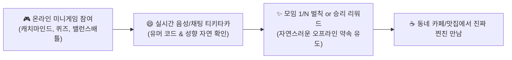
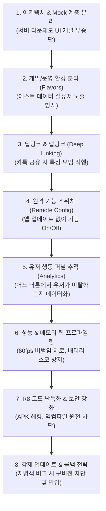

# 🏛️ OOMU (우무) 안드로이드 플레이스토어 정식 출시 & 게이미피케이션 찐친 마스터 로드맵 (v2)

> **대표님 비전 & 핵심 철학**:
> 1. **타겟 페르소나**: 30대 이상, 결혼/육아/직장으로 기존 친구들과 연락이 뜸해져 자연스러운 일상 찐친을 찾고 싶은 사람들
> 2. **만남의 확장 (Online to Offline)**: 부담스러운 1:1 오프라인 만남뿐 아니라, **게임/놀이를 통해 온라인에서 먼저 티키타카를 나누며 검증하는 '온라인 자만추'** 도입
> 3. **성장 플라이휠 (Women-First)**: 변태/조건/불량 유저 원천 차단 + 여성이 즐겁게 놀 수 있는 콘텐츠 ➔ 자연스러운 여성 유저 유입 ➔ 매너 있는 양질의 남성 유입
> 4. **개발 완성도 기준**: 바이브 코딩이 아닌 **5년 차 이상 시니어 모바일 개발자가 다루는 실제 프로덕션 표준 엔지니어링 워크플로우** 100% 적용

---

## 🎮 PART 1. [아이디어 10선] 여성 유저가 먼저 열광하는 "온라인 게이미피케이션 자만추"

부담스럽게 얼굴 사진 보고 "커피 마실래요?" 하는 헌팅 방식은 30대 여성 유저들이 가장 꺼려합니다.  
**가벼운 미니게임, 퀴즈, 노래, 취향 배틀을 통해 성격과 유머 코드를 먼저 확인하고 자연스럽게 친해지는 '놀이터'**를 만듭니다.

### 💡 엄선된 온라인 자만추 게이미피케이션 아이디어 10선

| 순번 | 기능명 | 게임 방식 및 상세 룰 | 여성 유저가 반응하는 포인트 & 자만추 효과 |
| :---: | :--- | :--- | :--- |
| **1** | **🎤 랜선 코노 배틀 (노래 점수 내기 & 벌칙)** | 30초~1분 하이라이트 음성 녹음 또는 실시간 음성방 ➔ 유저 투표 또는 음성 AI 음정 분석 ➔ 점수 최하위자가 다음 오프라인 커피 쏘기 벌칙 | 노래 잘 부르는 사람의 매력 발견, 웃긴 선곡으로 어색함 0% 해소 |
| **2** | **🎨 동네 캐치마인드 (3분 그림 퀴즈)** | 4~6명이 모여 한 명이 스마트폰 화면에 단어를 그리고 나머지가 채팅으로 정답 맞추기 | 그림을 못 그려도 빵 터지는 티키타카 발생, 가장 센스 있는 사람에게 호감도 집중 |
| **3** | **🔮 오늘의 동네 타로 & 사주 궁합 자만추** | 매일 아침 "오늘의 연애운/귀인운" 카드 뽑기 ➔ 나와 타로 궁합 90% 이상인 동네 이웃 자동 매칭 | 2030 여성 유저들의 최애 관심사(사주/타로), 자연스러운 대화 시작 트리거 |
| **4** | **⚖️ 실시간 밸런스 배틀 (끝장 토론방)** | "데이트 비용 7:3 vs 5:5", "깻잎 논쟁", "주말 집콕 vs 외출" 진영 선택 ➔ 3분 타이머 찬반 토론 | 연애관과 가치관을 미리 파악할 수 있어 이상한 사람을 1차 필터링 가능 |
| **5** | **🧩 2인 협동 미니 방탈출 (넌센스/상식 퀴즈)** | 남녀 2명이 한 팀이 되어 3분 안에 3개 문제를 함께 풀어야 방 탈출 성공 (성공 시 프로필 잠금 해제) | 서로 도와주며 자연스러운 동료애 형성, 실패해도 "아 까비 ㅋㅋㅋ" 하면서 대화 시작 |
| **6** | **🎵 인생곡 플레이리스트 블라인드 매칭** | 얼굴 사진 대신 각자의 "새벽 감성 인생 노래 3곡"을 등록 ➔ 노래 취향이 겹치는 사람끼리 음악 대화방 오픈 | "이 노래 아세요?!" 공통 음악 취향으로 감성적 유대감 형성 |
| **7** | **🐕 댕냥이 자랑 월드컵 (반려인 토너먼트)** | 내 강아지/고양이 사진을 올려 1:1 투표 배틀 ➔ 동네 반려인들끼리 주말 산책 메이트 결성 | 반려동물이라는 확실한 공통분모로 경계심 0%, 산책 모임으로 자연 연결 |
| **8** | **🍜 음식 취향 월드컵 (탕수육 부먹찍먹 ~ 평양냉면)** | 8강전 음식 호불호 토너먼트 ➔ 취향 일치율 100% 이웃에게 "주말에 이 맛집 같이 가실래요?" 초대장 전송 | 맛집 탐방은 30대 여성들의 참여율 1위 카테고리 |
| **9** | **🎭 아바타 블라인드 수다방 (10분 가면무도회)** | 귀여운 3D 동물 캐릭터 아바타로 10분간 텍스트/음성 대화 ➔ 10분 후 양쪽 모두 '호감' 선택 시 실제 프로필 공개 | 외모 편견 없이 대화 센스와 매너만으로 교감 |
| **10** | **🎯 소소한 일상 퀘스트 챌린지** | "오늘 퇴근길 노을 사진 올리기", "편의점 최애 신상 과자 추천" 등 주간 퀘스트 달성 시 하트 보상 | 일상을 공유하며 스며드는 '자만추(자연스러운 만남 추구)'의 정석 |

---

## 🛠️ PART 2. 5년 차 이상 시니어 모바일 개발자의 실제 'A to Z 기술 워크플로우'

비개발자나 초보 개발자는 `기획 ➔ 디자인 ➔ 코딩 ➔ 출시` 4단계만 생각합니다.  
하지만 **5년 차 이상 시니어 모바일 엔지니어는 출시 후 앱이 터지거나, 스토어에서 짤리거나, 사용자가 이탈하는 것을 막기 위해 아래 8단계의 고도화된 엔지니어링 파이프라인**을 반드시 거칩니다.

### 1단계: Clean Architecture & Mock API 계층 분리 (유연성)
- **실제 문제**: 백엔드 API가 아직 완성 안 됐거나 서버 작업 중일 때 프론트 개발이 멈추는 병목 현상.
- **시니어의 솔루션**: 
  - `Repository Pattern`을 적용하여 실제 Firestore 통신과 가상 데이터(Mock Data)를 플러그 꽂듯 교체 가능하게 분리.
  - 네트워크 없이도 비행기 모드에서 앱 전체 화면과 인터랙션을 100% 테스트 가능.

### 2단계: 다중 환경 분리 (Flavors: Dev vs Staging vs Prod)
- **실제 문제**: 개발 중에 테스트로 올린 '더미 모임', '어그로성 테스트 글'이 실제 사용자 앱에 그대로 노출되어 서비스 신뢰도 추락.
- **시니어의 솔루션**:
  - `dev`(개발용 Firebase 프로젝트)와 `prod`(상용 실서비스 프로젝트) 환경을 빌드 단계에서 완전히 격리.
  - 앱 아이콘에도 `[DEV]` 라벨을 붙여 개발자와 테스터가 절대 혼동하지 않도록 파이프라인 구축.

### 3단계: 딥링크(Deep Link) & 안드로이드 앱링크(App Links)
- **실제 문제**: 유저가 카카오톡으로 "야 이 모임 같이 가자!" 하고 링크를 보냈는데, 링크 누르면 그냥 앱 홈 화면만 뜨고 해당 모임을 찾을 수 없음.
- **시니어의 솔루션**:
  - `https://oomu.app/meetup/123` 형태의 유니버설 링크 구축.
  - 앱이 설치된 유저는 **해당 모임 상세 화면으로 0.1초 만에 다이렉트 랜딩**, 미설치 유저는 **구글 플레이스토어로 자동 이동 후 설치 완료 시 해당 모임으로 자동 복귀**.

### 4단계: 원격 구성(Remote Config) & 기능 플래그(Feature Flag)
- **실제 문제**: 새로 추가한 미니게임이나 특정 기능에 치명적인 버그가 터졌는데, 구글 플레이스토어 심사는 2~3일 걸려서 그동안 전체 평점이 1점으로 폭락함.
- **시니어의 솔루션**:
  - Firebase Remote Config를 연동하여, 앱 재배포나 심사 없이 **서버 스위치 하나로 문제된 기능을 1초 만에 숨김 처리(Kill Switch)**.

### 5단계: 유저 행동 퍼널 추적 (Event Tracking & Analytics)
- **실제 문제**: "유저가 100명 가입했는데 모임 신청은 왜 2명밖에 안 하지?" 원인을 감으로만 추측함.
- **시니어의 솔루션**:
  - 사용자 행동 단계마다 세밀한 이벤트 심기:
    `view_meetup_detail` ➔ `click_apply_btn` ➔ `fill_application_form` ➔ `complete_apply`
  - 유저가 신청서 폼 어디에서 작성하다가 포기하고 뒤로 가기를 눌렀는지 퍼널(Funnel) 데이터로 정밀 측정하여 UX 즉각 개선.

### 6단계: 메모리 누수(Leak) & 60fps 렌더링 프로파일링
- **실제 문제**: 사진이 많은 모임 목록을 위아래로 계속 스크롤하다 보면 폰이 뜨거워지면서 앱이 뚝뚝 끊기거나 튕김.
- **시니어의 솔루션**:
  - `CachedNetworkImage` 디스크/메모리 2중 캐싱 적용.
  - Flutter DevTools를 통해 위젯 리빌드 최소화, 불필요한 컨트롤러 `dispose()` 메모리 해제 검증으로 60fps 부드러운 스크롤 보장.

### 7단계: 코드 난독화 (R8/ProGuard) & 보안 해킹 차단
- **실제 문제**: 해커가 안드로이드 APK를 디컴파일하여 소스코드 원본과 API 키, 비즈니스 로직을 통째로 훔쳐 감.
- **시니어의 솔루션**:
  - `build.gradle`에서 `minifyEnabled true`, `shrinkResources true`, `proguard-rules.pro` 난독화 적용.
  - 소스코드를 외계어(`a.b.c()`)로 압축 난독화하고 앱 용량을 30% 이상 경량화.

### 8단계: 강제 업데이트(Force Update) & 안전 롤백 체계
- **실제 문제**: 옛날 버전 앱을 쓰는 유저의 DB 통신 규격이 바뀌어 에러가 발생하는데도 유저가 업데이트를 안 하고 방치함.
- **시니어의 솔루션**:
  - 앱 시작 시 서버의 최소 요구 버전(`min_required_version`)을 확인하여, 구버전 유저에게는 `"새로운 기능과 보안이 강화된 최신 버전으로 업데이트해주세요"` 팝업을 띄우고 플레이스토어로 연결.

---

## 🚀 PART 3. 안드로이드 정식 출시 실행 로드맵 (Action Schedule)

| 단계 | 목표 작업 내용 | 엔지니어링 산출물 | 소요 일정 |
| :---: | :--- | :--- | :---: |
| **Step 1 (필수 관문)** | **솔라피 SMS 본인인증 + 법적 약관 4종 + 회원탈퇴/신고/차단** | 플레이스토어 심사 리젝 0% 통과 패키지 | 차주 (1주) |
| **Step 2 (게이미피케이션)** | **여성 친화 온라인 자만추 1~2종 탑재 (캐치마인드 or 타로/밸런스배틀)** | 온라인 아이스브레이킹 놀이터 | 2주 |
| **Step 3 (통합 모임)** | **동네 Q&A 커뮤니티 + 일상번개/액티비티/주말여행 통합 프로세스** | 30대 찐친 커뮤니티 완성 | 1주 |
| **Step 4 (푸시 & 결제)** | **FCM 백그라운드 푸시 알림 + 구글 인앱결제(하트 충전)** | 리텐션 및 인앱 수익화 | 1주 |
| **Step 5 (시니어 QA)** | **Remote Config, 딥링크, Crashlytics, R8 난독화, 메모리 최적화** | 엔터프라이즈급 안정화 빌드 | 1주 |
| **Step 6 (스토어 배포)** | **Keystore 보안 서명, `.aab` 번들 생성, 구글 플레이 콘솔 심사 제출** | **구글 플레이스토어 정식 출시** | 1주 |

---

> 본 문서는 대표님의 피드백에 따라 지속적으로 진화하며, 안드로이드 1차 출시를 향해 단계별로 한 치의 오차 없이 실행됩니다.
