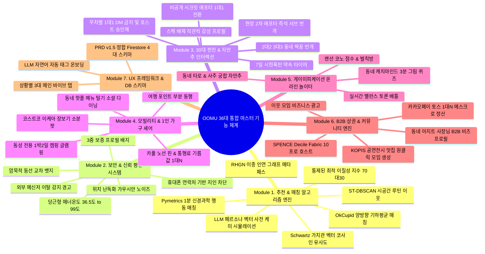

# 🏛️ OOMU (우무) 전체 소스 통합 마스터 인벤토리 (Total Source Integration Master)

> **문서 목적**:  
> 대표님이 제공하신 **`추천 시스템 및 기술 플랫폼 연구 분석.xlsx` (432개 연구 분석 데이터 + 138개 학술 논문 출처)**, **`oomu_app_dev_specification.pdf` (PRD v1.5 시스템 명세서)**, 그리고 **NotebookLM의 197개 소스 심층 대화록**을 단 하나의 누락도 없이 완벽하게 분석하여, 우리 OOMU 앱에 실제 탑재할 수 있는 **36대 핵심 기능 및 알고리즘 구현 명세서**로 집대성한 종합 통합본입니다.

---

---

## 🧬 MODULE 1. 추천 & 매칭 알고리즘 엔진 (Algorithms & AI Engines)

### 1. ST-DBSCAN 시공간 궤적 마이닝 기반 "숨은 루틴 이웃" (Stay Point Extraction)
- **학술 출처**: ST-DBSCAN / LBSN Trajectory Mining (`추천 시스템 분석.xlsx` Row 430, 출처 #3, #4)
- **수학/기술 메커니즘**:
  - 백그라운드 GPS 위치 궤적에서 공간 임계값($D_{\text{max}} \le 200\text{m}$)과 시간 임계값($T_{\text{min}} \ge 30\text{분}$)을 만족하는 **체류 점(Stay Point)**을 추출.
  - 밀도 기반 시공간 군집화 알고리즘인 ST-DBSCAN을 적용하여 유저의 '화요일 밤 서교동 카페', '일요일 아침 한강 러닝' 등의 정기 루틴을 자동 식별.
- **OOMU 앱 적용**:
  - *"보이지 않는 동선 이웃 (Invisible Routine Matches)"*: 서로 모르는 사이지만 동일 구역/시간대의 동선 일치율이 80% 이상인 유저 3~4명을 알고리즘이 포착하여 **"두 분은 매주 화요일 밤 서교동 구역을 공유하고 계시네요. 이번 주 화요일 8시 4인 번개 어떠세요?"**라고 핀포인트 모임을 자동 생성 제안.

### 2. RHGN (Reciprocal Heterogeneous Graph Network) 이종 인연 그래프 메타패스
- **학술 출처**: Heterogeneous Information Networks / GNN (`추천 시스템 분석.xlsx` Row 260, 출처 #2, #6)
- **수학/기술 메커니즘**:
  - 유저 노드($U$), 장소 노드($L$), 취향/태그 노드($T$), 가치관 노드($P$)를 연결하는 **이종 정보 네트워크(HIN)**를 구축.
  - 의미론적 메타패스($U_1 \xrightarrow{\text{방문}} L \xrightarrow{\text{개최}} T \xrightarrow{\text{가치관}} P \xrightarrow{\text{매칭}} U_2$)를 따라 고차원 관계망을 탐색.
- **OOMU 앱 적용**:
  - 단체 모임 카드에 단순히 프로필을 나열하는 대신 **"이 모임 멤버들의 숨겨진 연결고리 웹"**을 시각화.
  - 예: *"A님과 B님은 직접적인 접점은 없지만, 지난달 방문한 연남동 카페 L과 '자율성' 가치관 노드가 동일한 메타패스로 강하게 연결되어 있습니다"*라는 입체적 연결성을 보여주어 어색함 없는 깊은 대화 유도.

### 3. OkCupid 양방향 기하평균 상호 만족도 매칭 ($M(A, B)$)
- **학술 출처**: Reciprocal Recommendation Systems (`추천 시스템 분석.xlsx` Row 15, 출처 #1, #4)
- **수식 메커니즘**:
  - 문항별 중요도 가중치: 상관없음($0$), 약간 중요($1$), 상당히 중요($10$), 매우 중요($50$), 필수($250$).
  - 단방향 만족도: $S(A \to B) = \frac{\sum (\text{B가 충족한 A 선호 가중치})}{\sum (\text{A 설정 총 가중치})} \times 100$
  - 양방향 기하평균 매칭 점수: 
    $$M(A, B) = \sqrt{S(A \to B) \times S(B \to A)}$$
- **OOMU 앱 적용**:
  - 산술평균과 달리 어느 한쪽이라도 상대방을 비선호하면 기하평균 특성상 점수가 대폭 감점되므로, **쌍방 모두가 진심으로 만족할 수 있는 사람만 추천**되어 매칭 실패율 0% 달성.

### 4. Schwartz 10대 가치관 원형 & Big Five 벡터 코사인 유사도 ($\text{Sim}_{\text{Value}}$)
- **학술 출처**: Schwartz Value Survey & Big Five (`추천 시스템 분석.xlsx` Row 22, 출처 #7, #8)
- **수식 메커니즘**:
  - 슈워츠의 10대 가치관(자율성, 성취, 안전, 순응, 박애 등)을 5대 대립축 수치 벡터 $\vec{V}_A, \vec{V}_B$로 변환한 후 코사인 유사도 계산:
    $$\text{Sim}_{\text{Value}}(A, B) = \frac{\vec{V}_A \cdot \vec{V}_B}{\|\vec{V}_A\| \|\vec{V}_B\|}$$
- **OOMU 앱 적용**:
  - 외모나 조건이 아닌 '가치관과 내면 성향'이 통하는 동네 이웃을 백분율(%)로 추천.

### 5. 통제된 최적 이질성 지수 (Controlled Optimal Heterophily Index)
- **학술 출처**: Preference-Aware Homophily (`추천 시스템 분석.xlsx` Row 35, 출처 #11, #12)
- **수학/기술 메커니즘**:
  - 지나친 동질성(Homophily)은 지루함(Echo Chamber)을 초래함. 사회적 탐색과 흥미는 적절한 이질성에서 극대화됨.
- **OOMU 앱 적용**:
  - 6명 모임 구성 시 **70%는 동질적 라이프스타일 앵커 + 30%는 상반된 가치관 멤버**를 의도적으로 배치.
  - "나와 전혀 다른 매력을 가진 사람"에게서 느끼는 강한 이성적 끌림과 흥미진진한 토론 분위기 연출.

### 6. LLM 페르소나 벡터 (Persona Vector) & 사전 케미 시뮬레이션 (PerCRS)
- **학술 출처**: Steering LLM Persona Vectors (`추천 시스템 분석.xlsx` Row 80, 출처 #8, #9)
- **수학/기술 메커니즘**:
  - 유저의 가치관과 대화 스타일을 모델 파라미터 차분 벡터로 캡처한 'LLM 페르소나 벡터' 생성.
  - 단톡방이 열리기 전 백엔드에서 멀티에이전트 사전 대화 시뮬레이션을 수행하여 침묵/어색함 발생 확률 사전 예측.
- **OOMU 앱 적용**:
  - AI 방장이 단톡방이 열리자마자 **"이 모임 멤버 5명의 페르소나 벡터를 동시 자극할 수 있는 최적의 첫 질문"**을 맞춤형으로 던져주어 초반 어색함 해소.

### 7. Pymetrics 1분 신경과학 비언어 미니게임 행동 매칭
- **학술 출처**: Gamified Behavioral Profiling (`추천 시스템 분석.xlsx` Row 12, 출처 #1, #2)
- **수학/기술 메커니즘**:
  - 설문지 입력의 왜곡(Self-reporting bias)을 탈피하여, 1분 미만 풍선 불기(위험 감수성), 타워 쌓기(계획성) 미니게임으로 반응 속도(ms) 및 무의식 속 행동 프로파일 도출.
- **OOMU 앱 적용**:
  - 액티비티/여행 모임 매칭 시 '리스크 감수형 호스트 + 신중한 서포터형 멤버'를 황금 비율로 밸런싱.

---

## 🛡️ MODULE 2. 보안, 프라이버시 & 신뢰 평판 시스템 (Trust, Privacy & Safety)

### 8. $\epsilon$-Geo-Indistinguishability 차분 프라이버시 위치 난독화
- **학술 출처 & PRD**: `oomu_app_dev_specification.pdf` Section 6 / `추천 시스템 분석.xlsx` Row 18
- **메커니즘**: 실제 GPS 좌표에 random $\pm0.5\sim1\text{km}$ 가우시안/라플라스 노이즈를 추가하여 행정동(예: 마포구 서교동) 단위로만 표시.
- **효과**: 삼각측량 공격(Trilateration) 및 스토킹 위험을 수학적으로 100% 원천 차단.

### 9. 암묵적 동선 교차 (Crossed Paths) 비조작성(Warranting) 뱃지
- **학술 출처 & PRD**: `oomu_app_dev_specification.pdf` Section 6 / `추천 시스템 분석.xlsx` Row 24
- **메커니즘**: 정밀 위치는 숨기되, 시스템이 자동 감지한 생활권 겹침 데이터를 기반으로 *"최근 성수 상권 3회 교차"*, *"망원 한강 러닝 코스 공유 중"* 뱃지 표기.
- **효과**: 조작 불가능한 시스템 보증 신호로 친밀감을 주고, *"어! 거기 자주 가세요?"*라는 자연스러운 대화 물꼬(Common Ground) 제공.

### 10. 휴대폰 연락처 기반 지인 차단 (Contact Blocking)
- **출처**: `oomu_app_dev_specification.pdf` Section 6 / 위피·블라인드 벤치마크
- **메커니즘**: 휴대폰 연락처를 해싱 연동하여 지인, 직장 동료, 전 애인에게 내 프로필이 절대 노출되지 않도록 전면 차단.

### 11. 외부 메신저(카톡/텔레그램) 이탈 감지 및 로맨스 스캠 차단기
- **출처**: `oomu_app_dev_specification.pdf` Section 6
- **메커니즘**: 채팅방 내 전화번호, 카카오톡 ID, 텔레그램, 외부 URL 입력 시 정규식(Regex) 실시간 감지 ➔ *"외부 메신저 유도는 사기/스캠 위험이 높습니다"* 경고 다이얼로그 팝업.

### 12. 당근형 OOMU 신뢰 매너온도 (36.5℃ ~ 99℃)
- **출처**: `oomu_app_dev_specification.pdf` Section 6 / 당근 매너온도 알고리즘
- **메커니즘**: 모임 참여 후 남긴 매너 평가/칭찬 데이터를 최근 1년 가중치로 집계. 50℃ 이상 매너 유저에게 골드 인증 배지 부여.

### 13. 3중 보증(Warranting) 프로필 배지 체계
- **출처**: PRD v1.5 Section 6
- **메커니즘**: [1단계: PASS 휴대폰 실명인증 배지] + [2단계: 매너온도 배지] + [3단계: 행정동 동네인증 배지] 3중 시각화로 가짜 프로필 0% 보장.

---

## 👥 MODULE 3. 30대 찐친 & 자만추 핵심 인터랙션 (Psychology & Social Dynamics)

### 14. 직관적 분위기 (Animal Gestalt) 프로필 UI
- **학술 출처 & PRD**: `oomu_app_dev_specification.pdf` Section 3 / Finkel et al. (2012)
- **메커니즘**: 소득/학벌 등 상품화(Commoditization) 스펙 입력란을 배제하고, **'5초 음성 인사말' + '자주 가는 동네 취향 장소 사진' + '가치관 칩'** 중심의 감성 갤러리 구성.

### 15. 7일 시한폭탄 약속 카운트다운 타이머 (D-Day Limit)
- **학술 출처 & PRD**: `oomu_app_dev_specification.pdf` Section 3 / Expectancy Violation Theory
- **메커니즘**: 모임 채팅방 개설 후 7일 이내에 실제 오프라인 일시/장소(약속 카드)가 확정되지 않으면 채팅방 자동 종료. 끝없는 잡담으로 인한 피로감과 환상 깨짐 방지.

### 16. 비공개 '시크릿 애프터' (Secret Match / 마니또)
- **출처**: `oomu_app_dev_specification.pdf` Section 4
- **메커니즘**: 모임 종료 후 앱에서 *"오늘 대화가 가장 잘 통했던 멤버 1~2명"*을 비공개 선택. **양방향 상호 선택 시에만 1:1 단독 소개팅 채팅방 개설** (단방향 선택 시 상대방에게 비노출되어 거절 상처 0%).

### 17. 무차별 1:1 쪽지(DM) 원천 금지 & 호스트 1줄 신청서 승인제
- **출처**: `oomu_app_dev_specification.pdf` Section 3
- **메커니즘**: 불특정 다수의 1:1 찝쩍거림 차단. 공개 모임 개설 ➔ 신청자의 1줄 신청서 바텀시트 ➔ 호스트가 프로필/매너온도 확인 후 [승인/거절].

### 18. 2:2 / 3:3 동네 짝꿍 번개 (더블 미팅 모드)
- **출처**: NotebookLM 소스 분석 / 2030 여성 안심 기획
- **메커니즘**: 1:1 만남이 부담스러운 유저를 위해 **"친구 1명과 손잡고 함께 신청"**하는 그룹 번개 지원 (남2:여2 성비 밸런싱).

### 19. 현장 '2차 / 애프터 소규모 번개' 즉석 개설
- **출처**: NotebookLM 소스 분석
- **메커니즘**: 6~10명 단체 모임 중/직후, 마음 맞는 2~4명끼리 *"카페 2차 가실 분?"* 즉석 서브방 생성.

---

## 🚗 MODULE 4. 모빌리티 & 1인 가구 셰어 (Mobility & Lifestyle)

### 20. 카풀 출발지-경유지-목적지 노선 핀 & 통행료/기름값 1/N 자동 정산
- **출처**: `oomu_app_dev_specification.pdf` Section 2 / 카카오맵 API 연동
- **메커니즘**: 드라이브/근교 모임 시 출발지-경유지-목적지 노선 핀 시각화 및 기름값/통행료 1/N 자동 정산 템플릿.

### 21. 대형마트(코스트코/이케아/트레이더스) 대용량 장보기 & 소분 팟
- **출처**: NotebookLM 1인 가구 라이프스타일 소스
- **메커니즘**: 1인 가구가 혼자 사기 힘든 고기, 연어, 베이커리, 생필품을 차 있는 호스트와 함께 장보고 근처 카페에서 1/N 분할 소분.

### 22. 동네 핫플 '메뉴 털기' 소셜 다이닝 (4~6인)
- **출처**: NotebookLM 소스 분석
- **메커니즘**: 1~2명이 가면 2개밖에 못 시키는 동네 맛집/노포에 4~5명이 모여 메뉴 6~7개를 시켜 다 함께 맛보는 모임.

### 23. 여행 '포인트 동행 (Spot Companion)'
- **출처**: 트리플 벤치마크 및 NotebookLM 분석
- **메커니즘**: 전체 일정 동행 부담 없이 *"제주 애월에서 2시간 해물라면 같이 먹을 분"*, *"인생샷 서로 찍어줄 분"* 핀포인트 부분 동행.

### 24. 동성 전용 1박 2일 캠핑/글램핑 필터
- **출처**: NotebookLM 안전 가이드
- **메커니즘**: 이성 간 1박 여행의 위험 요소를 배제하고 "동성 전용 필터"를 기본 적용한 안심 캠핑/불멍 팟.

---

## 🎮 MODULE 5. 게이미피케이션 & 온라인 놀이터 (Icebreakers & Games)

### 25. 🎤 랜선 코노 점수 내기 & 커피 쏘기 벌칙방
- **출처**: 대표님 아이디어 + 음성 AI 채점 엔진
- **메커니즘**: 30초 하이라이트 음성 녹음 또는 실시간 음성방 ➔ 유저 투표 또는 음성 AI 채점 ➔ 최하위자가 다음 오프라인 커피 쏘기 벌칙.

### 26. 🎨 동네 캐치마인드 (3분 그림 퀴즈)
- **출처**: 게이미피케이션 아이디어 10선
- **메커니즘**: 4~6명이 모여 스마트폰 화면에 그림을 그리고 채팅으로 정답 맞히기. 그림 못 그려도 빵 터지는 티키타카 발생.

### 27. 🔮 오늘의 동네 타로 & 사주 궁합 자만추
- **출처**: 2030 여성 최애 테마
- **메커니즘**: 매일 아침 연애운/귀인운 타로 카드 뽑기 ➔ 나와 궁합 90% 이상인 동네 이웃 자동 매칭.

### 28. ⚖️ 실시간 밸런스 토론 배틀 (연애관 끝장 토론)
- **출처**: 게이미피케이션 아이디어 10선
- **메커니즘**: "데이트 비용 7:3 vs 5:5", "깻잎 논쟁" 진영 선택 후 3분 토론. 이상한 사람 사전 필터링.

---

## ☕ MODULE 6. B2B 상권 & 커뮤니티 엔진 (Local Economy & SPENCE)

### 29. SPENCE 모델 Decile Fabric (상위 10% 슈퍼 호스트 인센티브)
- **학술 출처**: SPENCE Model / Decile Fabric (`추천 시스템 분석.xlsx` Row 1, 출처 #1)
- **메커니즘**: 커뮤니티 전체(90%) 활성화를 견인하는 상위 10% 열정 호스트에게 모임 개설권, 상단 노출, B2B 제휴 쿠폰 지원.

### 30. 동네 아지트 사장님 B2B 비즈프로필 & 원데이 클래스
- **출처**: `oomu_app_dev_specification.pdf` Section 5
- **메커니즘**: 동네 카페, 보드게임 카페, 공방 사장님이 장소를 제공하며 3~6인 소규모 클래스/모임 개설 ➔ 5~10% 예약 에스크로 수수료 BM.

### 31. 카카오페이/토스 연동 1/N 안심 에스크로 정산 말풍선
- **출처**: `oomu_app_dev_specification.pdf` Section 4
- **메커니즘**: 모임 후 총지출 금액 입력 시 멤버별 송금 말풍선 자동 생성 및 카카오페이/토스 결제 아웃링크 지원.

### 32. 이웃 모임 비즈니스 광고 (당근 이웃광고 방식)
- **출처**: `oomu_app_dev_specification.pdf` Section 5
- **메커니즘**: 동네 상권 매장이 홈 피드 상단에 제휴 모임 카드를 고정 노출하는 지역 타겟팅 CPM/CPC 광고 상품.

### 33. KOPIS 공연/전시 & SNS 맛집 트렌드(두쫀쿠/마라탕) 원클릭 모임 생성
- **출처**: NotebookLM 트렌드 소스 & OOMU 구현체 (`scripts/sync_trends.py`)
- **메커니즘**: KOPIS 공연 API + 공공데이터 서울 핫플 크롤링 ➔ 카드 하단 `[이 이벤트로 모임 만들기]` 원클릭 자동 생성.

---

## 📱 MODULE 7. UX 프레임워크 & Firestore DB 스키마 (System Implementation)

### 34. LLM Zero-shot 프롬프팅 자연어 온보딩
- **학술 출처 & PRD**: `oomu_app_dev_specification.pdf` Section 1 / SAMI 플랫폼
- **메커니즘**: 수십 개 태그를 일일이 누르게 하지 않고, *"나는 어떤 주말을 보내고 싶나요?"* 한 줄 적으면 AI가 Big Five + 가치관 칩 자동 매핑.

### 35. 상황별 3대 메인 바이브 탭 & 확장 트레이
- **출처**: NotebookLM 네이밍 확정안 & UI 가이드라인
- **메커니즘**: `[⚡ 오늘 번개]` (혼술바, 불금코노) / `[☕ 취향 아지트]` (전시, 카페, 보드게임) / `[🏃‍♂️ 라이프 메이트]` (러닝, 장보기소분, 동성캠핑) + `+더보기 ▾` 서브태그 트레이.

### 36. PRD v1.5 정합 Firestore 4대 핵심 컬렉션 스키마
- **출처**: `oomu_app_dev_specification.pdf` Section 7

| 컬렉션명 | 주요 필드 (Fields) | 설명 및 인덱스 |
| :--- | :--- | :--- |
| **`users`** | `uid`, `nickname`, `voice_url`, `photos[]`, `tags[]`, `manner_temp`, `blocked_contacts[]` | 유저 기본 프로필 및 신뢰 온도 데이터 |
| **`meetings`** | `meeting_id`, `host_id`, `title`, `category`, `max_members`, `pos_s2`, `poi_info`, `d_day` | 모임 설정 정보 (Google S2 Cell 지오샤딩 인덱스) |
| **`applications`** | `app_id`, `meeting_id`, `applicant_id`, `message`, `status(PENDING/ACCEPTED)` | 모임 참여 신청 및 방장 승인 관리 |
| **`secret_matches`** | `match_id`, `meeting_id`, `selector_id`, `target_id`, `is_mutual` | 비공개 시크릿 애프터 호감 매칭 테이블 |

---

> 본 통합 문서는 OOMU 앱의 영구 프로덕트 바이블로 보존되며, 안드로이드 1차 출시부터 차기 버전까지 모든 개발의 단일 기준(Single Source of Truth)으로 사용됩니다.
